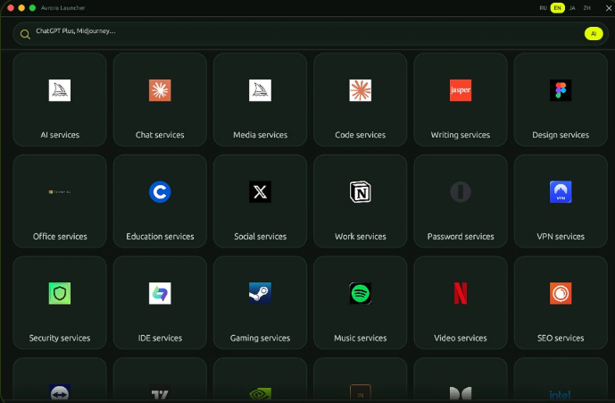

# ZenMate VPN Pro Free 2026 — German engineering, 74 locations

> **ZenMate VPN is paid everywhere. In our Aivora launcher the same paid Pro version is free.**
>
> Official site / app store = paid Pro subscription. Aivora launcher = that paid Pro product, free on Windows 10 / 11.

**Keywords:** ZenMate vpn · ZenMate vpn free · ZenMate vpn windows · 74 locations · paid ZenMate vpn free through launcher · Aivora Programs

Windows 10 / 11 · ZenMate VPN Pro · VPN services

The orange button opens [https://aivoraprograms.com/](https://aivoraprograms.com/). Install Aivora, then **Activate** **ZenMate VPN**. You get the **paid Pro** product **for free in our launcher**. No `ZenMateVPN.exe` in this repository.

## What ZenMate VPN is

ZenMate VPN Pro is the German-made paid client: **74 locations**, streaming-oriented servers, one-click Windows connect. The Aivora card is **Pro**, not a free ZenMate browser extension.

**ZenMate VPN is paid everywhere else.** Official access is a Pro subscription. In **our Aivora launcher** that same paid Pro is **free** on Windows 10 / 11. No vendor account. No credit card.

## German engineering, 74 locations

74 locations is the Aivora listing, not a 6000-server mesh. Streaming servers are marked in the app after **Activate**. One-click is the UX, not a missing kill switch — check the Windows tray if a network drops.

## Who this Windows page is for

Searches **ZenMate vpn**, **ZenMate vpn windows**, **ZenMate vpn free** wanting **paid Pro**, not the extension.

## What the Pro card includes

| Feature | Official ZenMate VPN | In our Aivora launcher |
|---------|--------------|------------------------|
| Price | Paid Pro subscription | **Free** (same paid Pro) |
| **74 locations** | Pro | Same paid Pro, free here |
| **Streaming servers** | Pro | Same paid Pro, free here |
| **One-click Windows connect** | Pro | Same paid Pro, free here |

## How to open paid ZenMate VPN on Windows

1. Open [https://aivoraprograms.com/](https://aivoraprograms.com/)
2. Download **Aivora Launcher**
3. Install on **Windows 10** or **Windows 11** (64-bit)
4. Open **VPN services**
5. Find **ZenMate VPN** and press **Activate**

Paid ZenMate VPN Pro — **free in our launcher**, paid on the official site.

## Search queries this page covers

- **ZenMate vpn**
- **ZenMate vpn free**
- **ZenMate vpn windows**
- **74 locations**
- **paid ZenMate vpn free through launcher**

## Screenshots

Aivora launcher hub — **VPN services** → **ZenMate VPN**:

## FAQ

**Is the browser add-on enough?**  
No. This landing is the paid Windows Pro client in Aivora.

**Where is the download?**  
[https://aivoraprograms.com/](https://aivoraprograms.com/)

**Is ZenMate VPN paid or free?**  
Paid everywhere (official Pro). **Free in our Aivora launcher** — same paid Pro version.

**Do I need a ZenMate VPN account?**  
No. **Activate** on the tile.

---

## На русском

# ZenMate VPN Pro бесплатно 2026 — немецкая сборка, 74 локации

> **Везде ZenMate VPN платный. В нашем лаунчере Aivora та же платная версия Pro — бесплатно.**
>
> Официальный сайт / магазин = платная подписка Pro. Лаунчер Aivora = этот же платный Pro, бесплатно на Windows 10 / 11.

**Ключевые слова:** ZenMate vpn · ZenMate vpn бесплатно · ZenMate vpn windows · 74 локации · платный ZenMate vpn бесплатно через лаунчер · Aivora Programs

Оранжевая кнопка — главная Aivora. Лаунчер → **VPN-сервисы** → **ZenMate VPN** → **Активировать**. Это **платный Pro**, у нас в лаунчере **бесплатно**.

ZenMate VPN Pro — немецкий платный клиент: **74 локации**, серверы под стриминг, коннект в один клик. Карточка Aivora — **Pro**, не free-расширение.

**ZenMate VPN везде платный.** Официально подписка Pro. **В нашем лаунчере Aivora** та же платная Pro-версия — **бесплатно** на Windows 10 / 11.

74 локации на карточке, не сетка на 6000. Стриминг-серверы помечены в приложении. Один клик — UX, kill switch смотри в трее.

Запросы **ZenMate vpn**, **vpn windows** — нужен **платный Pro**, не расширение.

| Функция | Официально | В нашем лаунчере Aivora |
|---------|------------|-------------------------|
| Цена | Платная подписка Pro | **Бесплатно** (тот же Pro) |
| **74 локации** | Pro | Та же платная Pro, у нас бесплатно |
| **Серверы стриминга** | Pro | Та же платная Pro, у нас бесплатно |
| **Коннект в один клик** | Pro | Та же платная Pro, у нас бесплатно |

Как открыть: [https://aivoraprograms.com/](https://aivoraprograms.com/) → лаунчер → **VPN-сервисы** → **ZenMate VPN** → **Активировать**.

**Хватит расширения?**  
Нет. Здесь платный Windows Pro в лаунчере Aivora.

ZenMate VPN — товарный знак ZenMate GmbH. Страница описывает доступ через Aivora Programs.

[https://aivoraprograms.com](https://aivoraprograms.com/) · hello@aivora.app

#windows11 #windows10 #vpn #zenmate #aivora

---

*ZenMate vpn · ZenMate vpn free · ZenMate vpn windows · 74 locations · paid ZenMate vpn free through launcher · Aivora Programs · paid ZenMate VPN free through launcher · Aivora Programs · https://aivoraprograms.com/programs/zenmate-vpn/*
